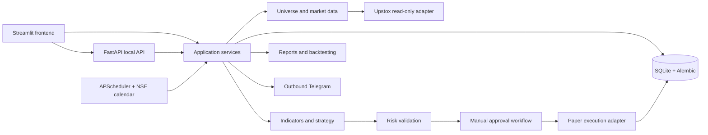

# System architecture

TradePilot is a local modular monolith. Streamlit renders the UI; FastAPI provides local service endpoints; both use shared deterministic domain modules and SQLAlchemy repositories over SQLite.

`config/` owns validated environment settings. `database/` owns models, repositories, transactions, backups, and versioned migrations. `integrations/upstox/` contains OAuth, token management, SDK adapter, request controls, and market-data validation. Strategy and risk modules are deterministic. Approval requires explicit user action. Paper execution is a separate SQLite-backed simulation adapter. `scheduler/` runs best-effort background jobs and records durable outcomes. `reports/` separates ledger-backed paper outcomes from one historical backtest result. Telegram is outbound only. The application does not implement broker order execution.

Secrets stay in environment configuration and are not returned to the frontend or stored in application tables. SQLite is local single-node storage; the scheduler uses a durable SQLite lease for the market pipeline. The API/UI default to loopback.
